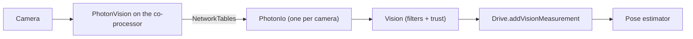

*Part of [[PhotonVision]]*

---

How to add a PhotonVision camera to the robot code, measure where it sits on the robot (its **transform**), and check that the robot is actually using it. Make sure you've done [[Connect and configure]] and [[Calibrate cameras]] first.

## Where the code lives
Everything is in `src/main/java/com/ck4911/vision/`. You'll only ever **edit** `VisionModule.java`, but it helps to know what the rest does:

| File | What it does |
| --- | --- |
| `VisionModule.java` | The list of cameras and where each one is on the robot. **This is the file you edit.** |
| `CameraConstants.java` | The settings for one camera: name, transform, how much to trust it, and its type. |
| `PhotonIo.java` | Talks to one PhotonVision camera and turns what it sees into robot pose guesses. |
| `Vision.java` | Takes every camera's guesses, throws out bad ones, and sends the good ones to the drivetrain. |
| `VisionConstants.java` | The numbers `Vision.java` uses to decide what counts as a bad guess. |

Here is the path the data takes, from the camera all the way to the robot knowing where it is:



This is the code version of what [[What is PhotonVision]] describes: the pose estimator keeps track of where we are with the wheels and gyro (dead reckoning), and PhotonVision corrects it whenever a camera sees an AprilTag.

## Before you start: PhotonVision settings
Our code has PhotonVision work out the 3D position of each tag, which only happens in **3D** mode. In the PhotonVision web dashboard, for each camera:

1. On the **Dashboard** page, set **Processing Mode** to **3D**.
2. In the **Output** tab (under the camera feed, next to Input and AprilTag), turn on **Do Multi-Target Estimation**. When the camera sees 2 or more tags at once, PhotonVision uses all of them together, which is much more accurate than using one.

\[picture: Dashboard with Processing Mode 3D and the Output tab's Do Multi-Target Estimation marked\]

If a camera is left in 2D mode, it will still show tags on the dashboard, but the robot gets no usable position from it.

## Adding a camera
Every camera is one method in `VisionModule.java`. Here is the back left camera:

```java
@Provides
@IntoSet
static CameraConstants bindsBackLeft() {
  var robotToCamera =
      new Transform3d(
          new Translation3d(-0.25, 0.3, 0.2),
          new Rotation3d(0, Math.toRadians(-35), Math.toRadians(90 + 35)));

  return CameraConstantsBuilder.builder()
      .name("BL")
      .robotToCamera(robotToCamera)
      .stdDevFactor(1.0)
      .type(CameraConstants.CameraType.PHOTONVISION)
      .build();
}
```

To add a camera, copy one of these methods, give it a new method name (like `bindsFrontLeft`), and change the 4 values:

- **`name`:** this **must exactly match** the name you gave the camera on the PhotonVision Dashboard in [[Connect and configure]], capital letters included. `"FL"` and `"fl"` are different cameras as far as the code is concerned. This is how the code finds the camera over NetworkTables.
- **`robotToCamera`:** where the camera is on the robot and which way it's pointing. See [[#Measuring the transform]].
- **`stdDevFactor`:** how much to trust this camera. Leave it at `1.0`. A higher number means "trust this camera less" (for example `2.0` for a camera that's known to be a bit off).
- **`type`:** always `PHOTONVISION` for these cameras.

That's it. `@Provides @IntoSet` automatically adds the camera to the list of cameras, so you don't have to register it anywhere else.

## Measuring the transform
The transform describes how to get from the center of the robot to the camera's lens. It has 2 parts: a **translation** (where the camera is) and a **rotation** (which way it's pointing).

> [!warning] Meters and radians
> All the code is in **meters** and **radians**. If you measured in inches, use `Units.inchesToMeters(...)` (from `edu.wpi.first.math.util.Units`). For angles, wrap degrees in `Math.toRadians(...)` like the example does.

### Translation: `new Translation3d(x, y, z)`
Measure from the **center of the robot, on the floor**, to the **center of the camera lens**:
- **x:** forward is positive, backward is negative.
- **y:** left is positive, right is negative.
- **z:** up is positive. This is just the height of the lens off the floor.

So the back left camera's `(-0.25, 0.3, 0.2)` means 25 cm behind the center, 30 cm to the left, and 20 cm off the floor.

### Rotation: `new Rotation3d(roll, pitch, yaw)`
- **roll:** leave this at `0` unless the camera is mounted sideways or tilted on its side.
- **pitch:** how much the camera is tilted up or down. **Negative is tilted up**, positive is tilted down. This one catches everyone. The back left camera's `-35` means it's tilted 35 degrees up.
- **yaw:** which way the camera faces when you look down at the robot from above. `0` is straight forward, `90` is left, `180` (or `-180`) is backward, and `-90` is right. The back left camera's `90 + 35 = 125` means it's facing backward and to the left.

\[picture: top-down drawing of the robot with the x/y axes, and a side view showing pitch\]

A tape measure gets you close enough to start. Measure as carefully as you can, because a camera that's off by a couple of degrees can make the robot think it's a lot further away from a tag than it really is.

### Fine-tuning the angles on a running robot
Angles are hard to measure, so you can adjust them while the robot is running. With tuning mode on (it's set in `RobotModule.java`), each camera puts 3 numbers on NetworkTables that you can change from Elastic or AdvantageScope:

- `Tuning/Vision/<name>/PitchDeg`
- `Tuning/Vision/<name>/YawDeg`
- `Tuning/Vision/<name>/HeadingOffsetDeg` (shifts the heading that camera reports, for when its idea of where the robot is facing is slightly off)

Park the robot somewhere you know the exact position of, then adjust the numbers until that camera's pose lines up with the real robot in AdvantageScope.

> [!warning] Tuned values aren't saved
> These numbers reset every time the code restarts. Once you've found good values, copy the pitch and yaw back into `VisionModule.java`. Tuning mode also needs to be **turned off for competitions**.

## How the robot decides what to trust
You don't need to change this to add a camera, but it's good to know why a camera's guess sometimes gets ignored. Every loop, `Vision.java` looks at each guess and **throws it out** if:

- it didn't use any tags,
- it only used 1 tag and the **ambiguity** is above `maxAmbiguity` (0.3). With a single tag, PhotonVision sometimes can't tell which of 2 possible positions is right, and ambiguity is how unsure it is,
- the robot would be floating or underground (the Z height is more than `maxZError` away from the floor),
- or the robot would be outside the field.

Guesses that survive get a **standard deviation**, which is how much to trust them. Lower means more trust. It's the baseline from `VisionConstants` × (distance to the tags)² ÷ (number of tags) × the camera's `stdDevFactor`. In plain English: **close tags and more tags = more trust**. Then it's handed to `Drive.addVisionMeasurement`, which blends it into the pose estimator.

The tag positions come from `providesFieldLayout()` in `VisionModule.java`. That has to be updated to the new field every season.

## Checking that it works
1. Deploy the code and power on the robot with the co-processor and cameras connected.
2. If the camera name in the code doesn't match the dashboard, or the camera isn't connected, the robot raises the alert **"Vision camera FL is disconnected."** (with your camera's name), which shows up in Elastic's Alerts widget. If you see it, check the spelling first.
3. Open AdvantageScope (see [[Basic uses of AdvantageScope]]) and look at:
   - `Vision/CameraFL/Connected` (with your camera's name): should be `true`.
   - `Vision/CameraFL/RobotPosesAccepted` and `RobotPosesRejected`: put them on the 3D field next to the robot's real pose. When the camera can see a tag, the accepted poses should sit right on top of the robot.

\[picture: AdvantageScope 3D field with the robot pose and a camera's accepted poses lined up\]

If the poses are consistently off in the same direction, the transform is probably wrong. Double check the signs (especially pitch), and that everything is in meters and radians.

## Next step
That's PhotonVision set up end to end. Head back to [[PhotonVision]] to check off what you've learned.

---
← Previous: [[Calibrate cameras]] | Up: [[PhotonVision]]
